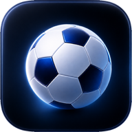

<div align="center">



# All Day I Dream About Sports

**Live football scores that drop right below your MacBook notch.**

A free menu bar app for people who are supposed to be working while their team plays. Goals, cards, VAR and full-time slide in under the notch, a capsule keeps the score in a corner, and you never open a browser tab.

[](LICENSE)
[](https://alldayidreamaboutsports.com)


[](https://alldayidreamaboutsports.com)
[](https://youtu.be/B75DYFddkV0)


</div>

<br>

## 📖 About

All Day I Dream About Sports follows Europe's top five leagues from your menu bar:

| ⚽ Premier League | ⚽ La Liga | ⚽ Serie A | ⚽ Bundesliga | ⚽ Ligue 1 |
|:-:|:-:|:-:|:-:|:-:|

Pick the clubs you care about, or follow a whole league. When something happens in one of their matches, it appears under the notch for a moment and then gets out of the way. There is no window to keep open, no Dock icon and no account.

**Made for:**
- 💻 Watching the match out of the corner of your eye during work
- 📺 Following a game you can't stream
- 🗓️ Midweek fixtures that kick off in the middle of your afternoon
- 🌍 Clubs in another time zone

<br>

## 📥 Download

<div align="center">

### 💻 On your Mac

*Launching on the Mac App Store. Direct downloads are no longer available.*


**Launch updates live at [alldayidreamaboutsports.com](https://alldayidreamaboutsports.com)**

</div>

<br>

## ✨ Why this app?

- **Free.** No subscription, no trial, no paid tier and no ads.
- **No account.** There is nothing to sign up for. Your teams and settings stay on your Mac.
- **Stays out of your way.** Alerts never take focus, and the score capsule never catches a click meant for the window behind it.
- **Open source.** Licensed under GPL-3.0, with the code right here.

<br>

## ⚡ Features

### 🔔 Every moment, dropped under the notch

Kickoff, goals, disallowed goals, yellow and red cards, half-time, the second half, full-time, extra time, penalty kicks, penalty shootouts, substitutions and VAR decisions all slide in below the notch as they happen.

### 🎚️ Pick how much you hear

Choose **Goals only**, **Key moments** or **Everything**, or open **Customize events** and switch each event type on or off yourself.

### 📌 A live score you can pin

Pin a live match of a team you follow and its score stays in the top-right corner of the screen, or the bottom. Pin several and they stack. Hover a capsule to see the whole timeline of goals, cards and substitutions, and choose small, medium or large.

### 🎉 Goal celebrations

When your team scores, the goal takes over the screen on a transparent overlay. Tap the ball for more. Hit **Preview goal animation** in Settings to see one any time.

### 🏟️ Your teams, or every match

The **My Teams** tab shows today's fixtures for the clubs you follow. The **All Teams** tab shows the full matchday across all five leagues.

### ⏱️ A clock that knows football

The minute ticks along between updates. Stoppage time shows as 45+3 or 90+, and own goals, penalty shootouts and aggregate scores are handled. A VAR decision that arrives late is held back instead of firing out of order.

### 🖥️ Fits into your Mac

Pick which screen the alerts appear on. The app follows light and dark mode, can open at login and lives only in the menu bar.

<br>

## 🚀 How to use it

1. Open the app. A short onboarding window walks you through it once
2. Click the icon in the menu bar and follow your teams, or tap **Follow all** for a whole league
3. Open Settings to choose your alerts, your screen and your capsule size
4. Go back to work. When a match starts, the alerts come to you
5. Click a live match in the menu and choose **Pin to screen** to keep its score in the corner

<br>

## ⚙️ How it works

```
                       ┌── only runs while matches are live
                       ▼
 API-Football ──▶ Cloud Run ──▶ Cloudflare R2 ──▶ CDN edge
                                                     │ 5s poll
                                  menu bar apps ◀────┘
```

- **Everything is polled, nothing is pushed or per user.** Match state sits in [Cloudflare R2][r2] as JSON with a 5-second TTL, and every Mac reads the same cached file through the [CDN][cdn]. One goal costs one write, however many people are watching.
- **Reads cost the same at any scale.** Cloudflare's [tiered caching][tiered] absorbs the rush when every copy expires at once, so the edge answers and R2 barely sees it.
- **[Cloud Scheduler][scheduler] drives [Cloud Tasks][tasks]**, which call [Cloud Run][run] to poll [API-Football][apifootball] every 5 seconds, one call per league, and publish what changed. Nothing sleeps, and CPU is billed per fetch.
- **Polling only runs inside a match window** (30 minutes before kickoff to 4 hours after), so cost follows the number of matches, not the number of users. Five leagues are live about 38 hours a week, not 168.
- **The app does the rest locally.** It diffs each new snapshot against the last to find new events, and runs celebrations on your Mac with no shared counts or user writes.
- **The App Store handles updates.** There is no remote config. To stop the app in an emergency, cut CDN access, as the [emergency-stop runbook](infra/README.md#emergency-stop-runbook) describes.

**Built with** [SwiftUI][swiftui] · [TypeScript][ts] + [Express][express] on [GCP Cloud Run][run] · [Cloudflare R2][r2] + [CDN][cdn] · [Eleventy][11ty] on [GitHub Pages][pages] · [GitHub Actions][actions]

<br>

## 👨‍💻 Building from source

| Component | Description | Documentation |
|-----------|-------------|---------------|
| **App** | Native SwiftUI menu bar app for macOS 14+, generated with XcodeGen | [`app/README.md`](app/README.md) |
| **Backend** | Cloud Run poller and internal API in TypeScript | [`backend/README.md`](backend/README.md) |
| **Infra** | One-time GCP and R2 setup scripts, plus the emergency-stop runbook | [`infra/README.md`](infra/README.md) |
| **Website** | Eleventy landing page and privacy policy | [`website/README.md`](website/README.md) |
| **Tester** | Staging-only tooling: fake publisher and load test | [`tester/README.md`](tester/README.md) |
| **CI** | Backend, app, security and website workflows | [`.github/workflows/README.md`](.github/workflows/README.md) |

**Quick start**

- App: `brew install xcodegen && cd app && xcodegen && open AllDayIDreamAboutSports.xcodeproj`
- Backend: `cd backend && npm install && npm test && npm run dev`
- Website: `cd website && npm install && npm run serve`

The unsigned Debug build needs no private Firebase config. A fork needs its own cloud projects, API-Football key, signing identity and bundle ID. See [CONTRIBUTING.md](CONTRIBUTING.md) for the full check list.

<br>

## 🚫 Contributions

**This project does not accept contributions.** Pull requests are read and considered, then closed without being merged. The app ships through the Mac App Store, and keeping every line under one copyright holder is what keeps that compatible with the GPL.

If a pull request has a fix or feature worth having, [@thisisnsh](https://github.com/thisisnsh) will make the change themselves, using the pull request as a reference.

You are free to fork the code under the terms of the [license](#-license). Bug reports and ideas are welcome as issues:

- [Report a bug or request a feature](https://github.com/thisisnsh/alldayidreamaboutsports/issues/new)
- Look through [open issues](https://github.com/thisisnsh/alldayidreamaboutsports/issues) first. A 👍 on one that already exists counts too.
- Report security problems privately, as described in [SECURITY.md](SECURITY.md).

<br>

## 📜 License

The original source code and bundled app icons are licensed under **[GPL-3.0-only](LICENSE)**. You may use, study, change and share them, but any copy or modified version you distribute must also be released under the GPL-3.0, with its source code. See [third-party notices](THIRD_PARTY_NOTICES.md) for what the license covers.

Not affiliated with FIFA, UEFA or any league or club. Team names, crests and marks belong to their owners.

<br>

## 💬 Support & contact

- Email: [hello@thisisnsh.com](mailto:hello@thisisnsh.com)
- Issues: [GitHub Issues](https://github.com/thisisnsh/alldayidreamaboutsports/issues)
- [Privacy Policy](https://alldayidreamaboutsports.com/privacy)

[11ty]: https://www.11ty.dev
[pages]: https://pages.github.com
[swiftui]: https://developer.apple.com/xcode/swiftui/
[ts]: https://www.typescriptlang.org
[express]: https://expressjs.com
[run]: https://cloud.google.com/run
[scheduler]: https://cloud.google.com/scheduler
[tasks]: https://cloud.google.com/tasks
[apifootball]: https://www.api-football.com
[r2]: https://developers.cloudflare.com/r2/
[cdn]: https://developers.cloudflare.com/cache/
[tiered]: https://developers.cloudflare.com/cache/how-to/tiered-cache/
[actions]: https://github.com/features/actions
